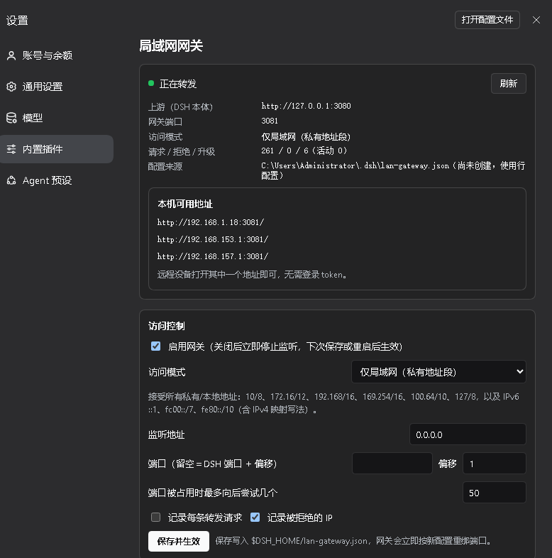

# dsh-lan-gateway

> 让局域网里的手机 / 平板 / 另一台电脑**打开网址就能用 DSH Web**——**一个插件**，不改 DSH 任何配置，随时开关，运行出问题也不影响 DSH 本身。



## 为什么做这个

想让手机、平板、另一台电脑用 DSH Web，常见做法是**两个插件配合**：一个改 DSH 启动让它监听网络，一个替换认证跳过 token。

代价很直接：

- 要改 DSH 的启动配置、替换它的 Connection 行 —— 与 DSH 版本强绑定；
- **DSH 一升级就失效**，轻则功能没了，重则整个 DSH 起不来，只能重装；
- 想恢复原样，得把改过的地方一处一处撤回去。

这个插件反过来：**一行配置都不改，只在 DSH 旁边多开一个端口。**

| | 常见的"改 DSH"方案 | 本插件 |
|---|---|---|
| 插件数量 | 2 个配合（改启动 + 跳过认证） | **1 个** |
| 动 DSH 配置 / 代码 | 要改 | **不改** |
| 开启 / 关闭 | 改配置，可能要重装 | 插件页一键开关，立即生效 |
| DSH 升级后 | 极易失效，甚至无法启动 | **照常升级**；接口若变，最多网关不工作 |
| 出问题的影响面 | 整个 DSH 起不来 | 网关不可用，**DSH 照常运行** |

## 原理（一句话）

在 DSH 旁边开一个端口做反向代理：请求按 IP 规则放行 → 把 Host/Origin 改写成 DSH 自己 → 注入 DSH 自己签发的会话 cookie。token 和 cookie 都在同一个进程内自动取得，**浏览器里永远看不到 token**，DSH 的认证、签名、401/403 全部原样生效。

```
手机/平板/别的电脑 ──HTTP──▶ 本插件 0.0.0.0:3081（默认 = Web 端口 +1）
                                   │  ① 按 IP 三档放行
                                   │  ② 改写 Host/Origin 为 127.0.0.1:3080
                                   │  ③ 注入 DSH 自己签发的会话 cookie
                                   ▼
                          DSH Web 127.0.0.1:3080（原样，未改动）
```

## 功能

| 功能 | 说明 |
|---|---|
| **端口转发** | 把 DSH Web 反代到相邻端口：默认 `Web 端口 + 1`；可显式指定；端口被占用自动 +1 递增（最多试 `maxPortScan` 个） |
| **免 token 远程访问** | 进程内取启动 token → 换会话 cookie → 注入每条转发请求（含 WebSocket）；远程设备无感，地址栏不出现 token |
| **IP 三档限制** | `lan`（默认，覆盖全部私有网段）/ `any`（任意 IP）/ `list`（精确 IP + CIDR；本机 loopback 始终放行，防自锁） |
| **设置面板** | 设置 → 内置插件 → 局域网网关：实时状态、本机可用地址、三档切换、端口/偏移、热生效 |
| **随 DSH 自动启动** | 作为 profile bundle 安装，重启 `dsh web` 自动生效 |
| **只读隔离** | 不修改 DSH 任何文件、不替换 BrowserAuth、不改 `connection`/`webserver` 行；零第三方依赖，宿主半只 import `node:` 内置模块 |

支持：静态资源、`/api` RPC、`/api/remote.mux` WebSocket 长连接、上传、SSE，IPv4 与 IPv6（`listenHost: "::"`）。

## 安装

```powershell
# 1) 把仓库放到一个固定目录（DSH 会 link 到它，别随手删）
git clone https://github.com/wlfzsd/dsh-lan-gateway.git D:\tools\dsh-lan-gateway

# 2) 装进 web profile —— 这一步会把依赖写成 link:，并且自动把
#    "dsh-lan-gateway" 追加到 dsh.profile.bundles（实测 pnpm v12 / dsh 0.2.2）
dsh plugin --profile web add D:\tools\dsh-lan-gateway

# 3) 重启 dsh web，控制台会打印：
#    [lan-gateway] listening on http://192.168.1.10:3081/ -> http://127.0.0.1:3080 (mode=lan)
```

若你的 `package.json` 里 `dsh.profile.bundles` 没有被自动追加，就在 Web 侧栏「插件」页启用它，或手工补一行。也可以直接在「插件 → 添加插件」里选这个本地目录。

卸载：`dsh plugin --profile web remove dsh-lan-gateway`，再从 `dsh.profile.bundles` 删掉那一行；或在插件页停用（DSH 立刻回到官方行为）。

## 配置

优先级：设置文件 `$DSH_HOME/lan-gateway.json` > profile 里的行配置 > 默认值。

```yaml
# $DSH_HOME/profiles/web/cordis.patch.yml（可选：改默认值）
- id: lan-gateway
  config:
    mode: list
    allow: ['192.168.1.0/24', '10.8.0.5']
```

| 键 | 默认 | 含义 |
|---|---|---|
| `enabled` | `true` | 是否监听 |
| `mode` | `lan` | `lan` / `any` / `list` |
| `allow` | `[]` | `list` 模式的 IP / CIDR |
| `listenHost` | `0.0.0.0` | 监听地址；`::` 为 IPv6 双栈 |
| `port` | `null` | 显式端口；`null` = Web 端口 + `portOffset` |
| `portOffset` | `1` | 默认偏移 |
| `maxPortScan` | `50` | 占用时最多向后试几个 |
| `verbose` / `logRejected` | `false` / `true` | 请求日志 / 拒绝日志（1 秒节流） |

`lan` 档覆盖：IPv4 `10/8`、`172.16/12`、`192.168/16`、`169.254/16`、`100.64/10`（CGNAT/Tailscale）、`127/8`；IPv6 `::1`、`fc00::/7`、`fe80::/10`；含 `::ffff:a.b.c.d` 映射写法。

## 安全边界（务必读）

- 从网关进来 = **DSH 的 owner 权限**（能开终端、读写文件、跑工具），没有"每个远程用户一个身份"这层。
- **只在可信网络开**；`any` 等于把控制权交给任何能连到该端口的地址。
- 明文 HTTP（与 DSH 本地监听一致）。要加密请给 DSH 配 `--tls-cert/--tls-key`，网关会自动走 https 上游。
- 面板接口 `/api/lan-gateway` 位于 DSH 自己的认证栅栏内，只有 owner 能读写。

## 隔离与失效边界

插件只做四件事：读两个稳定接口（`webServer.host/port/protocol`、`connection.authenticatedUrl()`）、多开一个监听、注册一个 `/api/lan-gateway` 路由、写自己的设置文件。**不碰** DSH 安装目录、不改环境变量、不注册进程级 handler、不用 `globalThis`、不删除任何文件。

坏掉时也不会拖垮 DSH（实测）：`apply` 抛错 → 插件失活、DSH 正常；设置文件坏 JSON → 按默认值继续；端口全占 → 递增或只记问题；包缺失 → profile 跳过该 bundle。

唯一能影响 DSH 启动的耦合是 `package.json` 的 `dsh.client` 声明与 `client.js` 必须同时存在（DSH 的 client-modules 是 required 行）。改完本仓库先跑：

```powershell
node verify.mjs     # 契约检查 + 只读不变量门禁（禁 globalThis / process.on / 环境变量赋值 / process.exit / 删除 API）
```

不想要设置面板？把 `package.json` 里 `dsh.client` 整块删掉即可，网关功能不受影响，DSH 侧零风险。

## 兼容性

- 实测：`@deepseek-ai/dsh` **0.2.2-alpha.2** + Node 26（Windows）。
- 依赖的两个接口在 0.1.x / 0.2.x 系列都存在；若未来 DSH 改了 `authenticatedUrl` 或 `webServer` 契约，插件会表现为"502 / 无监听"，不会影响 DSH 本体。
- 不要和"替换 Connection 行"的插件（如 `dsh-skip-browser-auth`）同时启用，它会让 `ctx.connection` 不再是官方实现。

## 开发与验证

```powershell
node verify.mjs                 # 包契约 + 只读不变量
node test/unit.mjs              # IP 解析 / 三档匹配 / cookie / header 改写（88 项）
node test/client-shape.mjs      # 客户端 bundle 形状
node test/client-render.mjs     # 面板渲染路径
```

完整验证记录（26 项端到端、真实浏览器、故障注入）见 [docs/VERIFICATION.md](docs/VERIFICATION.md)。

## 文件

| 文件 | 作用 |
|---|---|
| `index.js` | 宿主半：反向代理（HTTP + Upgrade）、IP 三档、端口扫描、token→cookie、面板 API、配置热加载 |
| `client.js` | 浏览器半：`settings.plugins.tab` 一页（手写 CJS bundle，只 `require('react')`，无构建步骤） |
| `cordis.patch.yml` | bundle 补丁：插入 `lan-gateway` 行 |
| `verify.mjs` | 重启前预检 + 只读不变量门禁 |
| `test/` | 单测与冒烟测试 |

## License

[MIT](LICENSE)
